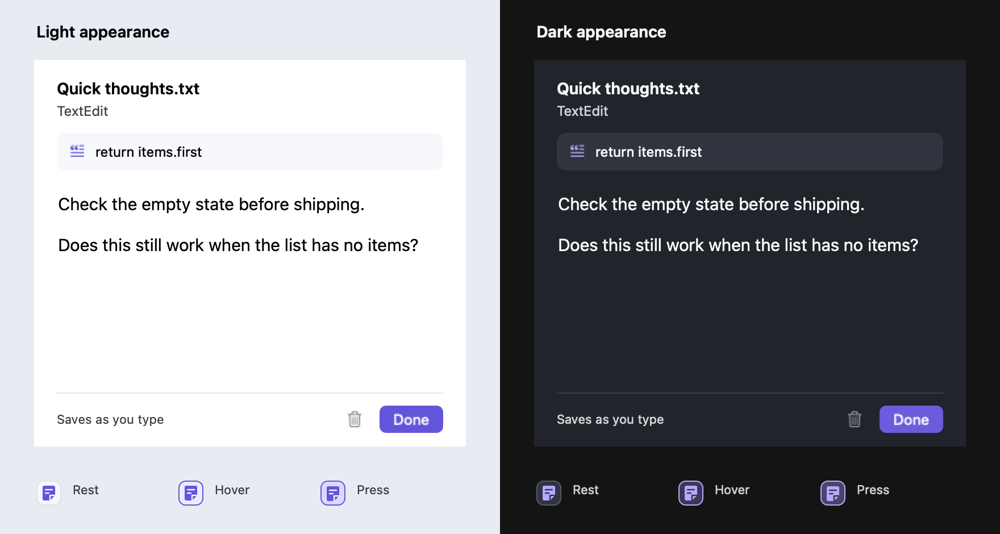
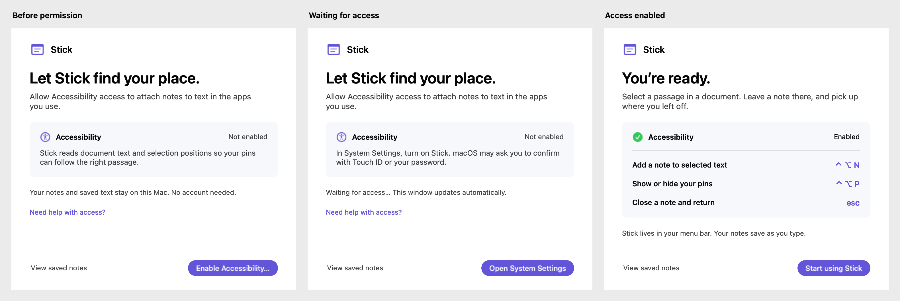
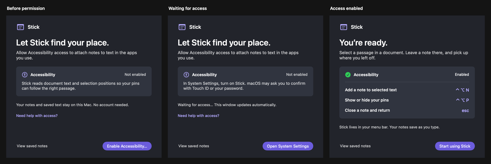

# Live macOS validation

Validated on 24 November 2026 using a saved TextEdit document with distinct anchors at lines 40 and 60. A temporary, user-approved Swift harness sent system-wide keyboard and mouse events and read Accessibility and WindowServer state. This exercised the running app rather than calling its command handlers directly.

| Check | Result |
| --- | --- |
| Control–Option–N at each passage | Created two separate note IDs with the correct selected quotes |
| Enter different note text | Both bodies autosaved independently |
| Control–Option–P | Revealed and hid both pins |
| Both passages visible | Two distinct 26 × 26 pin windows, vertically aligned with their respective text |
| Click each pin | Reopened the correct body and anchor; note editor received keyboard focus |
| Escape | Closed the editor and returned focus to TextEdit |
| Restart Stick | Both IDs, bodies and anchors survived; both pins could be revealed and reopened |
| Core suite | 13 tests passed |

The test found and fixed a focus-restoration issue: an editor previously returned to the most recently active external app. It now retains its own source application's process ID.

To repeat manually, save a plain-text document containing two distinct passages approximately 20 lines apart. Select each passage and use Control–Option–N to save different notes. Scroll until both passages are visible, reveal the pins with Control–Option–P, and open each pin to check its note. Repeat after quitting and reopening Stick.

This result covers the TextEdit workflow on the development Mac. Safari and VS Code have separate Accessibility diagnostics described in the README; this run does not establish complete workflows in those apps or universal compatibility.

## Pin and editor appearance refresh

Rechecked the refreshed build on 24 November 2026. In TextEdit, Control–Option–P hid and revealed both saved pins, each pin opened its own note with keyboard focus, and Escape returned focus to TextEdit. Restarting the refreshed build preserved both notes. Both pin windows remained 26 × 26 points and aligned with their original passages.

Rendered the actual AppKit views in light and dark appearances, including resting, hovered, and pressed pin states, and at the editor's minimum size. Inspected the running dark-mode editor as well. The 13 core tests and release build passed. These visual changes do not extend the app-compatibility coverage described above.

## Permission onboarding

Validated the refreshed setup flow on 24 November 2026. The running app showed the permission explanation, moved to a waiting state after Enable Accessibility, and opened the correct system permission list through Open System Settings. Recovery help expanded with both the primary action and app-location button visible.

This development build needed its stale permission entry refreshed after rebuilding. After the current app was added in System Settings, the still-running setup window automatically changed to “You’re ready” with the shortcut guide. No restart or manual permission-check button was needed for that transition. Start using Stick closed setup and opened the saved-note list.

After setup, restarting Stick opened the saved-note list without repeating onboarding. Both existing TextEdit pins were visible together and each was reopened with its correct body and anchor during the post-setup checks; Escape returned focus to TextEdit. A later edit changed the second anchor’s saved prefix from “Line 60” to “Line 6v0”, so that pin became unplaced as designed. The edited sample was preserved.

All 19 tests passed: the 13 anchor/store tests plus six AppKit onboarding tests with injected permission hooks. The onboarding tests cover silent checks, access granted after a request, pregranted access, revocation before Continue, dismissal/revisit, and failed Settings launches. Light and dark states were rendered from the actual AppKit views. The release build also passed.

